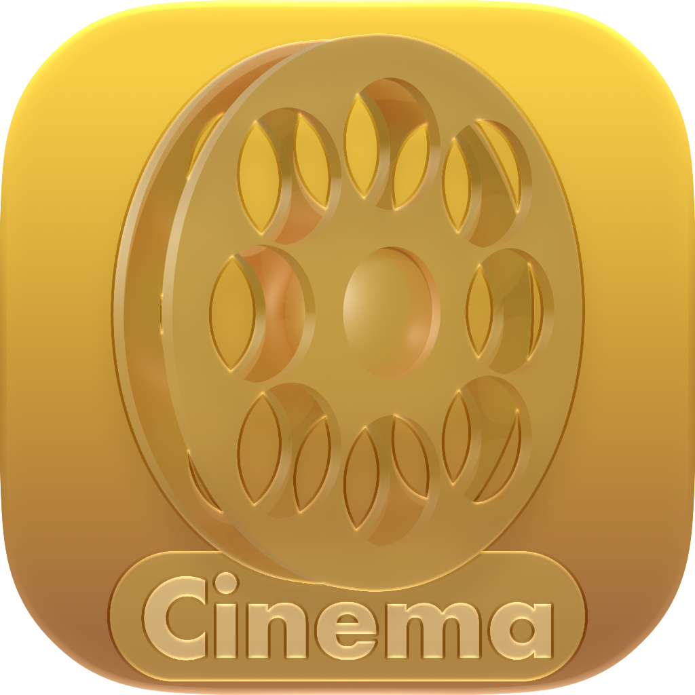

<h1 align="center">ComfyCinema</h1>

<p align="center">
  
</p>

<p align="center">
  ComfyCinema is a personal movie and TV discovery client with native SwiftUI and Fire TV interfaces, plus a standalone LG webOS TV app.
</p>

<p align="center">
  The Apple and Android clients share Kotlin Multiplatform models, TMDB networking, and display-server URL logic. The LG app implements the corresponding behavior in JavaScript.
</p>

## Features

- **Movie & TV Discovery** — Search movies and TV shows using TMDB, with optional adult-content filtering.
- **Live TV** — Browse and stream live television channels.
- **Favorites & Watch History** — Save your favorites and keep track of what you've watched.
- **Custom Collections** — Create and organize personalized movie and TV show collections.
- **Movies & TV Shows** — Play movies or browse TV shows by season and episode.
- **Persistent Server Selection** — Choose a playback server and retain your preference across sessions on each device.
- **Native Fire TV Experience** — Built with Jetpack Compose, featuring D-pad navigation, WebView cursor controls, page reloading, and fullscreen playback.
- **Content Filtering** — Android request and popup filtering powered by shared blocking-rule lists.
- **LG webOS Support** — Dedicated TV interface with discovery, search, favorites, collections, watch history, and embedded playback. See [LGTVScratch/README.md](LGTVScratch/README.md) for setup instructions and platform limitations.

## Screenshots

### iOS

<p align="center">
  
</p>

### macOS

<p align="center">
  
</p>

### Android / Fire TV

<p align="center">
  
</p>

Playback availability depends on the selected third-party server.


<h2>Architecture</h2>

<p align="center">
  <strong>Kotlin Multiplatform</strong>
  <br/>
  <sub>Shared Models · TMDB Networking · Server Logic</sub>
</p>

<table align="center">
  <tr>
    <th align="center">🍎 Apple</th>
    <th align="center">📺 Android / Fire TV</th>
    <th align="center">📺 LG webOS</th>
  </tr>
  <tr>
    <td align="center">
      SwiftUI<br/>
      <sub>iOS & macOS</sub>
    </td>
    <td align="center">
      Jetpack Compose<br/>
      <sub>Kotlin Multiplatform</sub>
    </td>
    <td align="center">
      JavaScript<br/>
      <sub>Standalone implementation</sub>
    </td>
  </tr>
</table>

<p align="center">
  <sub>
    Apple and Android share Kotlin Multiplatform logic.
    LG webOS independently implements equivalent functionality.
  </sub>
</p>


## Credits

ComfyCinema was developed by Aryan Rogye.

The SwiftUI implementation, shared business logic, and application architecture were developed by Aryan Rogye. The Android/Fire TV interface was implemented with assistance from OpenAI Codex.

This product uses the [TMDB API](https://www.themoviedb.org/) but is not endorsed or certified by TMDB.

## Project layout

| Path | Purpose |
| --- | --- |
| `MoviesAPIClient/` | SwiftUI app for Apple platforms |
| `MoviesAPICore/` | Swift Package for iOS and macOS, created for faster previews |
| `MoviesShared/sharedLogic/` | Kotlin Multiplatform models, TMDB client, and display-server behavior |
| `MoviesShared/androidApp/` | Native Jetpack Compose Fire TV app and Android WebView implementation |
| `LGTVScratch/` | Standalone LG webOS TV app; see its README for setup and platform limits |

## Configure TMDB

Create your own TMDB API read-access token. Do not commit it.

### Apple app

Copy the template and add the token:

```shell
cp Config.example.xcconfig Config.xcconfig
```

```xcconfig
APIReadAccessToken = your_token
```

Open `MoviesAPIClient.xcodeproj` in Xcode and run the app.

### Fire TV app

Create `MoviesShared/local.properties`:

```properties
TMDB_API_READ_ACCESS_TOKEN=your_token
```

`MoviesShared/local.properties` is ignored by Git. The Android build also accepts the token from a Gradle property or the `TMDB_API_READ_ACCESS_TOKEN` environment variable.

## Build iOS or macOS

Both the iOS and macOS apps depend on the `MoviesAPICore` Swift package, which requires the Kotlin Multiplatform (KMP) framework to be built first.

To build and update the shared framework, run:

```shell
./MoviesAPICore/update-shared-logic.sh
```

Once the framework is built, open `MoviesAPIClient.xcodeproj` in Xcode and build or run the desired target.

## Build the Fire TV app

From `MoviesShared`:

```shell
./gradlew :androidApp:assembleDebug
adb install -r androidApp/build/outputs/apk/debug/androidApp-debug.apk
```

The Android app targets Fire TV's Leanback launcher and does not require a touchscreen. Use the remote to move focus; Select activates controls. In the player, the on-screen cursor sends click events to the embedded page, and Back returns focus to native controls or exits fullscreen.

## Android content blocking

The Android client keeps its implementation inside `androidApp`. It packages the canonical network and popup rule sources from the Apple project, translates compatible network rules into Android request matching, intercepts matching WebView requests, and uses DOM filtering for popup-style elements. It does not reuse WebKit APIs or compiled WebKit rule formats.

## Development notes

- Use `./gradlew :androidApp:assembleDebug` for the quickest Android iteration.
- Avoid `clean` during normal work; Gradle's configuration cache and build cache are enabled.
- `sharedLogic` is shared infrastructure. Keep platform UI, persistence, focus handling, and WebView behavior in their respective app targets.

## License

MIT. See [LICENSE](LICENSE).
